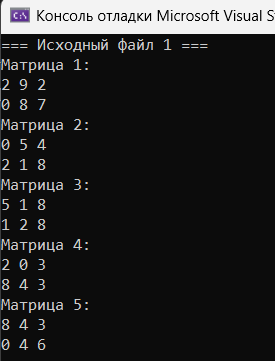
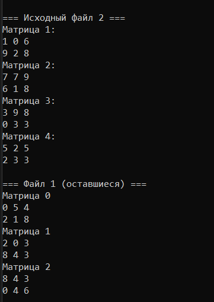
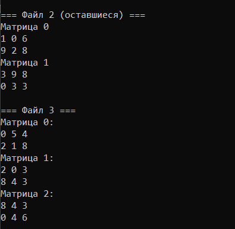

# Лабораторная работа № 1

## Файловые потоки ввода-вывода. Работа с текстовыми и бинарными файлами

**Выполнил:** Утов Алим А.

---

## 📋 Содержание

1. [Цель работы](#1-цель-работы)
2. [Задание](#2-задание)
3. [Код программы](#3-код-программы)
4. [Результаты работы программы](#4-результаты-работы-программы)
5. [Выводы](#5-выводы)


---

## 1. Цель работы:

Разработка программ на языке С++ с использованием файловых потоков ввода-вывода. Научиться разрабатывать программы на языке С++ для обработки текстовых и бинарных файлов.

---
 ## 2. Задание:

Вариант 12: в первом файле хранится k матриц порядка m × n, во втором - l матриц.
Поменять местами все нечетные (1, 3, 5,… по порядковому номеру в
файле) матрицы из первого файла с четными матрицами (0, 2, 4, …)
второго файла (до конца меньшего из файлов). Оставшиеся в большем
файле матрицы переписать в третий файл. Вывести на экран содержимое первого и второго файлов.

---
## 3. Код программы:
Подключение библиотек и функция разделения вектора на части
```cpp

#include <vector>
#include <iostream>
#include<cmath>
#include<utility>
using namespace std;
pair<vector<int>, vector<int>> part(const vector<int>& v) {
    int n = (int)v.size();
    int pol = n / 2;
    int tr = n / 3;

    vector<int> half(v.begin(), v.begin() + pol);     // первая половина
    vector<int> third(v.begin() + tr, v.begin() + 2 * tr);  // средняя треть

    return { half, third };
}
```
Главная функция: ввод и заполнение вектора
```cpp
int main() {
    setlocale(0, "");
    int n;
    cout << "Введите количество элементов вектора n:\n";
    cin >> n;
    vector<int> v(n);
    for (int i = 0; i < n; i++) {
        v[i] = rand() % 50;
    }
    cout << "Заполненый вектор\n";
    for (int i = 0; i < n; i++) {
        cout << v[i] << " ";
    }
```
Главная функция: ввод и заполнение вектора
```cpp
    int pol = n / 2, tr = n / 3, sr2, sr3, sum = 0, par1 = 0, par2 = 0, max1 = 0,max2=0;
```
Обработка первой половины вектора
```cpp
        for (int i = 0; i < pol; i++) {
        sum += v[i];
        sr2 = sum / pol;
    }
    cout << "\nСреднее арифметическое первой половины:" << sr2 << endl;
    for (int i = 0; i < pol; i++) {
        if (v[i] % 17 == 0) {
            if (v[i] > v[i + 1]) {
                max1 = v[i];
            }
        }
    }
    cout << "Максимальное число кратное 17 в первой части:" << max1 << endl;

    for (int i = 0; i < pol - 1; i++) {
        if (v[i] + v[i + 1] > max1) {
            par1++;
        }
    }
    cout << "Количество пар первой части:" << par1 << endl ;
    //
    
```
Обработка средней трети вектора
```cpp
for (int i = tr; i < 2 * tr; i++) {
        sum += v[i];
        sr3 = sum / tr;
    }
    cout << "Среднее арифметическое средней трети:" << sr3 << endl;

    for (int i = tr; i < 2 * tr; i++) {
        if (v[i] % 17 == 0) {

            if (v[i] > v[i + 1]) {
                max2 = v[i];
            }
        }
    }
    if (max2 == 0) {
    cout << "В средней части нет чисел,кратных 17" << endl << "Количество пар 0";
    }
    else {
        cout << "Максимальное число кратное 17 в средней части:" << max2 << endl;
        for (int i = tr; i < (2 * tr) - 1; i++) {
            if (v[i] + v[i + 1] > max2) {
                par2++;
            }
        }
        cout << "Количество пар второй части части:" << par2 << endl;
    }
    return 0;
}
```

---
## 4. Результаты работы программы





---
## 5. Выводы

В ходе выполнения лабораторной работы я научился работать с одномерными массивами (векторами) в языке C++, а именно:

- Освоил базовые операции с контейнером `std::vector`: объявление, заполнение случайными числами и вывод на экран.
- Научился делить вектор на логические части (первую половину и среднюю треть) для их дальнейшей обработки.
- Закрепил навыки написания циклов для поиска среднего арифметического, подсчета количества пар элементов и поиска максимального значения по заданному условию (кратность 17).
