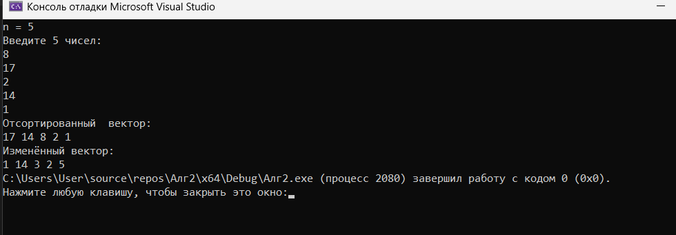
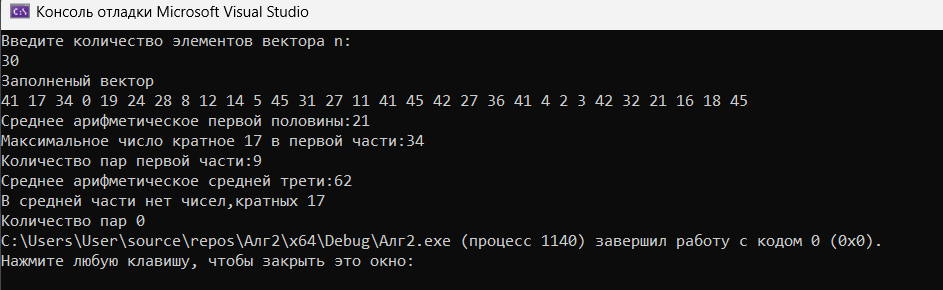

# Лабораторная работа № 2

## Векторы. Итераторы

**Выполнил:** Утов Алим А.

---

## 📋 Содержание

1. [Цель работы](#1-цель-работы)
2. [Задание](#2-задание)
3. [Код программы](#3-код-программы)
4. [Результаты работы программы](#4-результаты-работы-программы)
5. [Ответы на контрольные вопросы](#5-ответы-на-контрольные-вопросы)
6. [Выводы](#6-выводы)

---

## 1. Цель работы:

Научиться разрабатывать алгоритмы с использованием одномерных массивов и векторов.

---

## 2. Задание:

**Номер варианта – 2.**

**Задание 1:** Напишите программу, которая:
1. Запрашивает у пользователя целое число n, затем создаёт вектор из n целых чисел, вводимых с клавиатуры.
2. Сортирует вектор по убыванию.
3. Заменяет каждый чётный по индексу элемент (0, 2, 4, ...) на его порядковый номер в отсортированном векторе (начиная с 1).
4. Выводит изменённый вектор.

**Задание 2:** Написать функцию part, принимающую вектор и возвращающую а) первую половину, б) среднюю треть его элементов (тоже как вектор). Найти средние арифметические каждой части. А также определите количество пар последовательностей каждой части, сумма элементов которой больше максимального числа в последовательности, кратного 17.

---

## 3. Код программы:

**Задание 1.**
Подключение библиотек и  пространства имен


```cpp
#include <vector>
#include <iostream>
using namespace std;
```
Главная функция и ввод вектора
```cpp
 int main() {
    setlocale(0, "");
    int n;
    cout << "n = ";
    cin >> n;

    vector<int> v(n);
    cout << "Введите " << n << " чисел:\n";
    for (int i = 0; i < n; ++i) {
        cin >> v[i];}
 ```
 
 Сортировка и вывод вектора по убыванию

```cpp
    //сортировка
    for (int i = 0; i < n - 1; ++i) {
        for (int j = 0; j < n - 1 - i; ++j) {
            if (v[j] < v[j + 1]) {
                swap(v[j], v[j + 1]);
            }
        }
    }
    cout << "Отсортированный  вектор:\n";
    for (int i = 0; i < n; i++) {
        cout << v[i] << " ";
    }
```
Замена чётных по индексу элементов и вывод

```cpp
    //замена
    for (int i = 0; i < n; i += 2) {

        v[i] = i + 1;
    }
    //вывод
    cout << endl;
    cout << "Изменённый вектор:\n";
    for (int i = 0; i < n; i++) {
        cout << v[i] << " ";
    }
    return 0;
}
```
**Задание 2.** Подключение библиотек и функция part
```cpp
#include <vector>
#include <iostream>
#include<cmath>
#include<utility>
using namespace std;
pair<vector<int>, vector<int>> part(const vector<int>& v) {
    int n = (int)v.size();
    int pol = n / 2;
    int tr = n / 3;

    vector<int> half(v.begin(), v.begin() + pol);     // первая половина
    vector<int> third(v.begin() + tr, v.begin() + 2 * tr);  // средняя треть

    return { half, third };
}
```
Главная функция: ввод и заполнение вектора

```cpp
int main() {
    setlocale(0, "");
    int n;
    cout << "Введите количество элементов вектора n:\n";
    cin >> n;
    vector<int> v(n);
    for (int i = 0; i < n; i++) {
        v[i] = rand() % 50;
    }
    cout << "Заполненый вектор\n";
    for (int i = 0; i < n; i++) {
        cout << v[i] << " ";
    }
```
Объявление переменных

```cpp
    int pol = n / 2, tr = n / 3, sr2, sr3, sum = 0, par1 = 0, par2 = 0, max1 = 0,max2=0;
```
Обработка первой половины вектора

```cpp
    // 
    for (int i = 0; i < pol; i++) {
        sum += v[i];
        sr2 = sum / pol;
    }
    cout << "\nСреднее арифметическое первой половины:" << sr2 << endl;
    for (int i = 0; i < pol; i++) {
        if (v[i] % 17 == 0) {
            if (v[i] > v[i + 1]) {
                max1 = v[i];
            }
        }
    }
    cout << "Максимальное число кратное 17 в первой части:" << max1 << endl;

    for (int i = 0; i < pol - 1; i++) {
        if (v[i] + v[i + 1] > max1) {
            par1++;
        }
    }
    cout << "Количество пар первой части:" << par1 << endl ;
    //
```
Обработка средней трети вектора

```cpp
    for (int i = tr; i < 2 * tr; i++) {
        sum += v[i];
        sr3 = sum / tr;
    }
    cout << "Среднее арифметическое средней трети:" << sr3 << endl;

    for (int i = tr; i < 2 * tr; i++) {
        if (v[i] % 17 == 0) {

            if (v[i] > v[i + 1]) {
                max2 = v[i];
            }
        }
    }
    if (max2 == 0) {
    cout << "В средней части нет чисел,кратных 17" << endl << "Количество пар 0";
    }
    else {
        cout << "Максимальное число кратное 17 в средней части:" << max2 << endl;
        for (int i = tr; i < (2 * tr) - 1; i++) {
            if (v[i] + v[i + 1] > max2) {
                par2++;
            }
        }
        cout << "Количество пар второй части части:" << par2 << endl;
    }
    return 0;

}
```
---
## 4. Результаты работы программы


Компиляция 1 программы
---

Компиляция 2 программы 
---
## 5. Ответы на контрольные вопросы
1. Какой заголовочный файл нужно подключить, чтобы использовать vector?
#include <vector>

2. Как определить и инициализировать переменную типа vector?
std::vector<int> v; (пустой) или std::vector<int> v = {1, 2, 3}; (сразу с элементами).

3. Как изменить число элементов в векторе?
Метод resize(): v.resize(10);

4. Как добавить элемент в конец вектора?
Метод push_back(): v.push_back(42);

5. Как узнать число элементов вектора?
Метод size(): v.size();

6. Как определить переменную, содержащую матрицу?
std::vector<std::vector<int>> matrix;

7. Что такое итератор?
Объект, указывающий на элемент контейнера (похож на указатель), используется для перебора элементов.

8. Как определить переменную типа итератор?
std::vector<int>::iterator it; или auto it = v.begin();

9. Что можно делать с итераторами вектора?
Перемещаться (++, --, +, -), разыменовывать (*it), сравнивать (==, !=).

10. Какие итераторы и как можно получить по переменной типа вектор?
begin() — на первый элемент, end() — на элемент после последнего, rbegin()/rend() — обратные, cbegin()/cend() — константные.

11. Как вставить элемент в заданную позицию вектора?
Метод insert(): v.insert(v.begin() + 2, 100);

12. Как удалить из вектора элемент в заданной позиции или диапазоне?
Метод erase(): v.erase(v.begin() + 2); (один) или v.erase(v.begin() + 1, v.begin() + 3); (диапазон).

13. Как удалить из вектора элементы с заданным значением, или по определенному условию?
Через std::remove (или std::remove_if) и erase: v.erase(std::remove(v.begin(), v.end(), 5), v.end());

14. Как перебрать подряд все элементы вектора?
Через цикл for по индексу (for (int i=0; i<v.size(); i++)), через for (auto x : v) или через итераторы.

15. Что можно делать с помощью алгоритма copy?
Копировать диапазон элементов в другой контейнер или поток.

16. Что можно делать с помощью алгоритма find?
Искать первое вхождение элемента в диапазоне. Возвращает итератор или end().

17. Как перезаписать содержимое вектора элементами из указанного диапазона?
Метод assign(): v.assign(other.begin(), other.end());
---
## 6. Выводы
В ходе выполнения лабораторной работы я научился работать с контейнером std::vector в C++ и изучил его основные возможности:

Освоил объявление, инициализацию, заполнение и изменение размера вектора.

Научился сортировать векторы и обращаться к элементам по индексу для их замены.

Изучил итераторы: научился получать их (begin(), end()), перемещаться по контейнеру и использовать в алгоритмах.

Разобрался с алгоритмами из библиотеки **algorithm** (такими как copy, find, remove).

Научился писать шаблонные функции для работы с векторами любого типа.

Закрепил навыки работы с функциями, возвращающими несколько значений (через std::pair).