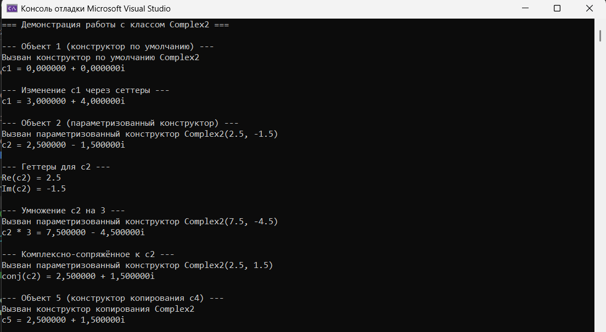
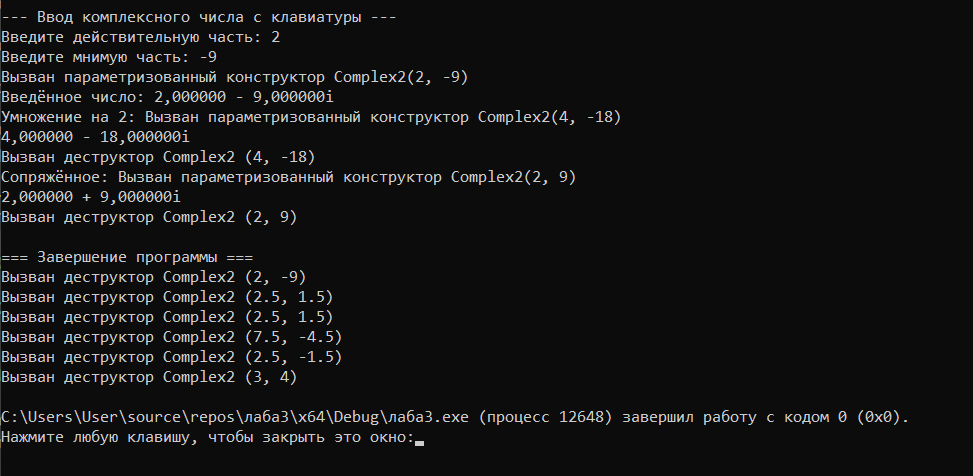

# Лабораторная работа № 3

## Создание простых классов. Методы-аксессоры (геттеры/сеттеры)

**Выполнил:** Утов Алим А.

---

## 📋 Содержание

1. [Цель работы](#1-цель-работы)
2. [Задание](#2-задание)
3. [Код программы](#3-код-программы)
4. [Результаты работы программы](#4-результаты-работы-программы)
5. [Ответы на контрольные вопросы](#5-ответы-на-контрольные-вопросы)
6. [Выводы](#6-выводы)

---

## 1. Цель работы:

Научиться создавать простые классы, определять поля и методы, реализовывать конструкторы, использовать спецификаторы доступа для инкапсуляции данных, создавать методы доступа (геттеры и сеттеры) для работы с закрытыми полями.

---

## 2. Задание:

**Средний уровень. Вариант 12. Класс Complex2 (Комплексное число).**

Создать класс с полями: действительная часть, мнимая часть.

Реализовать в классе:
- Конструктор по умолчанию
- Параметризованный конструктор
- Конструктор копирования
- Деструктор (с сообщением об уничтожении объекта)
- Геттеры и сеттеры для всех полей
- Две функции обработки данных:
  1. Умножить на заданное число
  2. Вычислить комплексно-сопряжённое число
- Функцию формирования строки информации об объекте

Создать проект для демонстрации работы: сформировать объекты с константными значениями и с введёнными с клавиатуры значениями. Выводить результаты на экран.

---

## 3. Код программы:

### Файл Complex2.h (Объявление класса)

Объявление класса и приватные поля

```cpp
#pragma once 
#include <string>
using namespace std;

class Complex2 {
private:
    double real;  // действительная часть
    double imag;  // мнимая часть
```
Публичная часть: конструкторы, деструктор, геттеры и сеттеры

```cpp
public:
    // Конструкторы
    Complex2();                                          // по умолчанию
    Complex2(double r, double i);                        // параметризованный
    Complex2(const Complex2& other);                     // копирования

    // Деструктор
    ~Complex2();

    // Геттеры
    double getReal() const;
    double getImag() const;

    // Сеттеры
    void setReal(double r);
    void setImag(double i);
``` 
Функции обработки данных и формирования строки

```cpp
    // Функции обработки
    Complex2 multiplyBy(double k) const;   // умножить на заданное число
    Complex2 conjugate() const;            // комплексно-сопряжённое

    // Формирование строки информации об объекте
    string toString() const;
};
```
**Файл Complex2.cpp** (Реализация методов)
Подключение библиотек и реализация конструкторов

```cpp
#include "Complex2.h"
#include <iostream>
#include <sstream>
#include <cmath>
using namespace std;

// Конструктор по умолчанию
Complex2::Complex2() : real(0.0), imag(0.0) {
    cout << "Вызван конструктор по умолчанию Complex2" << endl;
}

// Параметризованный конструктор
Complex2::Complex2(double r, double i) : real(r), imag(i) {
    cout << "Вызван параметризованный конструктор Complex2("
        << r << ", " << i << ")" << endl;
}

// Конструктор копирования
Complex2::Complex2(const Complex2& other) : real(other.real), imag(other.imag) {
    cout << "Вызван конструктор копирования Complex2" << endl;
}
```
Реализация деструктора, геттеров и сеттеров

```cpp
// Деструктор
Complex2::~Complex2() {
    cout << "Вызван деструктор Complex2 ("
        << real << ", " << imag << ")" << endl;
}

// Геттеры
double Complex2::getReal() const { return real; }
double Complex2::getImag() const { return imag; }

// Сеттеры
void Complex2::setReal(double r) { real = r; }
void Complex2::setImag(double i) { imag = i; }
```
Реализация функций обработки данных и вывода

```cpp
// Умножение на заданное число k
Complex2 Complex2::multiplyBy(double k) const {
    return Complex2(real * k, imag * k);
}

// Комплексно-сопряжённое число: z* = real - i*imag
Complex2 Complex2::conjugate() const {
    return Complex2(real, -imag);
}

// Строка информации об объекте
string Complex2::toString() const {
    string result = to_string(real);
    if (imag >= 0)
        result += " + " + to_string(imag) + "i";
    else
        result += " - " + to_string(fabs(imag)) + "i";
    return result;
}
```
**Файл main.cpp** (Демонстрация работы)
Подключение библиотек и демонстрация конструктора по умолчанию

```cpp
#include <iostream>
#include <locale>
#include <windows.h>
#include "Complex2.h"
using namespace std;

int main() {
    setlocale(0, "");
    cout << "=== Демонстрация работы с классом Complex2 ===\n" << endl;
    
    // --- Объект 1: конструктор по умолчанию ---
    cout << "--- Объект 1 (конструктор по умолчанию) ---" << endl;
    Complex2 c1;
    cout << "c1 = " << c1.toString() << endl << endl;

    // --- Изменение через сеттеры ---
    cout << "--- Изменение c1 через сеттеры ---" << endl;
    c1.setReal(3.0);
    c1.setImag(4.0);
    cout << "c1 = " << c1.toString() << endl << endl;
```
Демонстрация параметризованного конструктора и геттеров

```cpp
    // --- Объект 2: параметризованный конструктор ---
    cout << "--- Объект 2 (параметризованный конструктор) ---" << endl;
    Complex2 c2(2.5, -1.5);
    cout << "c2 = " << c2.toString() << endl << endl;

    // --- Геттеры ---
    cout << "--- Геттеры для c2 ---" << endl;
    cout << "Re(c2) = " << c2.getReal() << endl;
    cout << "Im(c2) = " << c2.getImag() << endl << endl;
```
Демонстрация функций обработки: умножение и сопряжение

```cpp
    // --- Метод 1: умножение на заданное число ---
    cout << "--- Умножение c2 на 3 ---" << endl;
    Complex2 c3 = c2.multiplyBy(3.0);
    cout << "c2 * 3 = " << c3.toString() << endl << endl;

    // --- Метод 2: комплексно-сопряжённое ---
    cout << "--- Комплексно-сопряжённое к c2 ---" << endl;
    Complex2 c4 = c2.conjugate();
    cout << "conj(c2) = " << c4.toString() << endl << endl;
```
Демонстрация конструктора копирования и ввода с клавиатуры

```cpp
    // --- Конструктор копирования ---
    cout << "--- Объект 5 (конструктор копирования c4) ---" << endl;
    Complex2 c5 = c4;
    cout << "c5 = " << c5.toString() << endl << endl;

    // --- Ввод с клавиатуры ---
    cout << "--- Ввод комплексного числа с клавиатуры ---" << endl;
    double r, i;
    cout << "Введите действительную часть: ";
    cin >> r;
    cout << "Введите мнимую часть: ";
    cin >> i;

    Complex2 cUser(r, i);
    cout << "Введённое число: " << cUser.toString() << endl;

    cout << "Умножение на 2: "
        << cUser.multiplyBy(2.0).toString() << endl;
    cout << "Сопряжённое: "
        << cUser.conjugate().toString() << endl;

    cout << "\n=== Завершение программы ===" << endl;
    return 0;
}
```
---
## 4. Результат работы программы




---
## 5. Ответы на контрольные вопросы
1. Что такое класс? Чем класс отличается от объекта?
Класс — это пользовательский тип данных, описывающий структуру (поля) и поведение (методы). Объект — это конкретный экземпляр класса, созданный в памяти. Класс — это чертёж, объект — это изделие по чертежу.

2. Для чего нужны спецификаторы доступа public и private?
public открывает доступ к членам класса извне (интерфейс). private скрывает внутренние данные от внешнего вмешательства, обеспечивая инкапсуляцию и защиту состояния объекта.

3. В чём суть инкапсуляции?
Инкапсуляция — это объединение данных и методов работы с ними в единое целое (класс) с сокрытием внутренней реализации. Пользователь класса работает только через публичный интерфейс, не вмешиваясь во внутреннее устройство.

4. Зачем нужны геттеры и сеттеры, если можно сделать поля открытыми?
Геттеры и сеттеры позволяют контролировать доступ: проверять корректность вводимых значений в сеттерах (валидация), делать поля «только для чтения» (только геттер), а также менять внутреннее представление данных без изменения интерфейса для пользователя.

5. Что такое конструктор? Какие виды конструкторов существуют?
Конструктор — специальный метод, вызываемый при создании объекта для его инициализации. Виды: по умолчанию (без параметров), параметризованный (с аргументами), копирования (принимает другой объект того же класса).

6. Чем конструктор отличается от обычного метода?
Имя конструктора совпадает с именем класса, у него нет возвращаемого типа (даже void), и он вызывается автоматически при создании объекта. Обычный метод имеет свой тип возврата и вызывается явно.

7. Для чего нужен деструктор? Когда он вызывается?
Деструктор нужен для освобождения ресурсов (например, динамической памяти), занятых объектом. Вызывается автоматически при уничтожении объекта (выход из области видимости, удаление через delete).

8. Что такое список инициализации и зачем он нужен?
Список инициализации — это часть конструктора после двоеточия, где поля инициализируются до входа в тело конструктора (Class() : x(0), y(0) {}). Нужен для инициализации константных полей, полей-ссылок и для более эффективной работы (без промежуточного присваивания).

9. Что означает ключевое слово const после списка параметров метода?
Это означает, что метод является константным — он не изменяет поля объекта. Такие методы можно вызывать у константных объектов.

10. Почему поля класса рекомендуется делать закрытыми?
Чтобы защитить данные от случайного или намеренного изменения извне, обеспечить целостность состояния объекта и скрыть детали реализации (принцип «чёрного ящика»), оставив доступ только через контролируемые методы.
---
## 6. Вывод
В ходе выполнения лабораторной работы я научился создавать классы в C++ и применять принципы объектно-ориентированного программирования:
- Освоил объявление классов, закрытых полей и публичных методов.

- Научился реализовывать конструкторы (по умолчанию, параметризованный, копирования) и деструктор.

- Изучил назначение геттеров и сеттеров и научился их использовать для безопасной работы с полями.

- Реализовал функции обработки данных для комплексных чисел (умножение на число и получение сопряжённого).

- Научился формировать строку с информацией об объекте для вывода на экран.

- Закрепил навыки работы с объектами, созданными как с константными значениями, так и с вводом с клавиатуры.