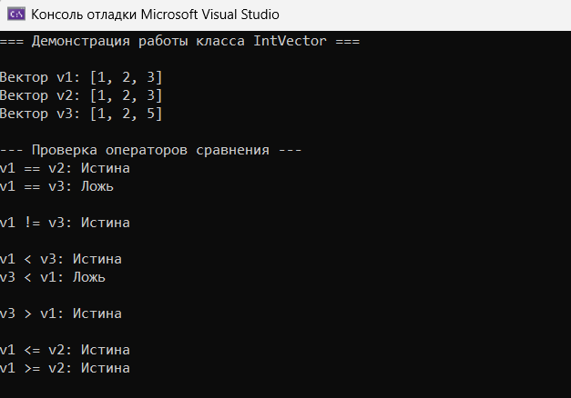
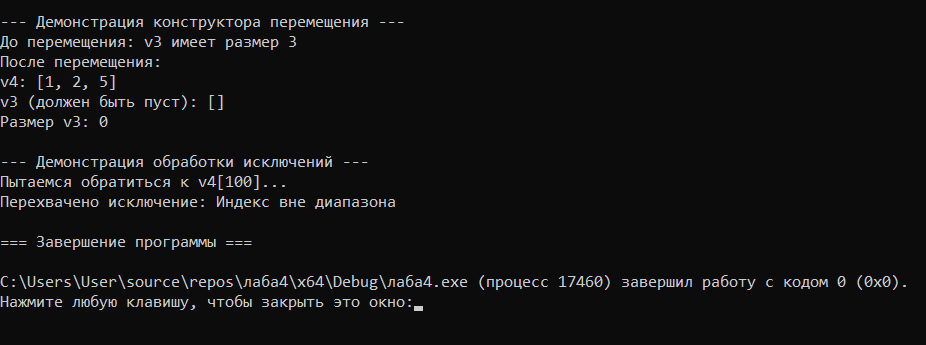

# Лабораторная работа № 4

## Управление динамической памятью. Правило трёх и пяти

**Выполнил:** Утов Алим А.

---

## 📋 Содержание

1. [Цель работы](#1-цель-работы)
2. [Задание](#2-задание)
3. [Код программы](#3-код-программы)
4. [Результаты работы программы](#4-результаты-работы-программы)
5. [Ответы на контрольные вопросы](#5-ответы-на-контрольные-вопросы)
6. [Выводы](#6-выводы)

---

## 1. Цель работы:

Закрепить теоретические знания о классах, конструкторах, деструкторах и инкапсуляции на практике, научиться реализовывать класс, управляющий динамической памятью, освоить «правило трёх» и «правило пяти», получить навыки работы с динамическими массивами в объектно-ориентированной парадигме, развить умение проектировать интерфейс класса, обеспечивающий безопасную работу с данными.

---

## 2. Задание:

**Продвинутый уровень. Вариант 2.**

Общее задание: Реализовать класс `IntVector` с поддержкой «правила пяти» (конструктор перемещения и оператор присваивания перемещением), исключениями и дополнительной функциональностью.

Дополнительная функциональность (Вариант 2): Реализовать операторы сравнения: `==`, `!=`, `<`, `>`, `<=`, `>=` для сравнения двух векторов.

---

## 3. Код программы:

### Файл IntVector.h (Объявление класса)

Приватные поля и вспомогательный метод

```cpp
#pragma once
#include <iostream>

class IntVector {
private:
    int* data;       // указатель на динамический массив
    int size;       
    int capacity;    

    // Вспомогательный метод для изменения емкости
    void reserveInternal(int newCapacity);
```
Конструкторы, деструктор и операторы присваивания (Правило пяти)

```cpp
public:
    // --- Конструкторы и деструктор (Правило пяти) ---
    IntVector();                                         // по умолчанию
    IntVector(int n);                                    // с параметром (размер)
    IntVector(const IntVector& other);                   // копирования
    IntVector(IntVector&& other) noexcept;               // перемещения
    ~IntVector();                                        // деструктор

    // --- Операторы присваивания ---
    IntVector& operator=(const IntVector& other);        // копированием
    IntVector& operator=(IntVector&& other) noexcept;    // перемещением
```
Основные методы и оператор доступа по индексу

```cpp
    // --- Основные методы ---
    void pushBack(int value);       
    void popBack();                 // удалить с конца
    int getSize() const;
    int getCapacity() const;
    bool isEmpty() const;
    void print() const;

    // --- Оператор доступа по индексу ---
    int& operator[](int index);
    const int& operator[](int index) const;
```
Операторы сравнения (Задание варианта 2)

```cpp
    bool operator==(const IntVector& other) const;
    bool operator!=(const IntVector& other) const;
    bool operator<(const IntVector& other) const;
    bool operator>(const IntVector& other) const;
    bool operator<=(const IntVector& other) const;
    bool operator>=(const IntVector& other) const;
};
```
Файл IntVector.cpp (Реализация методов)
Подключение библиотек и метод расширения памяти

```cpp
#include "IntVector.h"
#include <stdexcept> 
#include <algorithm> 

using namespace std; 

void IntVector::reserveInternal(int newCapacity) {
    if (newCapacity <= capacity) return;
    int* newData = new int[newCapacity];
    for (int i = 0; i < size; ++i) {
        newData[i] = data[i];
    }
    delete[] data;
    data = newData;
    capacity = newCapacity;
}
```
Реализация конструкторов

```cpp
IntVector::IntVector() : data(new int[10]), size(0), capacity(10) {}

IntVector::IntVector(int n) : size(n), capacity(n > 0 ? n : 1) {
    if (n < 0) {
        throw invalid_argument("Размер не может быть отрицательным");
    }
    data = new int[capacity];
    for (int i = 0; i < size; ++i) {
        data[i] = 0;
    }
}

IntVector::IntVector(const IntVector& other) : size(other.size), capacity(other.capacity) {
    data = new int[capacity];
    for (int i = 0; i < size; ++i) {
        data[i] = other.data[i];
    }
}

IntVector::IntVector(IntVector&& other) noexcept
    : data(other.data), size(other.size), capacity(other.capacity) {
    other.data = nullptr;
    other.size = 0;
    other.capacity = 0;
}
```
Деструктор и операторы присваивания

```cpp
IntVector::~IntVector() {
    delete[] data;
}

IntVector& IntVector::operator=(const IntVector& other) {
    if (this != &other) {
        int* newData = new int[other.capacity];
        for (int i = 0; i < other.size; ++i) {
            newData[i] = other.data[i];
        }
        delete[] data;
        data = newData;
        size = other.size;
        capacity = other.capacity;
    }
    return *this;
}

IntVector& IntVector::operator=(IntVector&& other) noexcept {
    if (this != &other) {
        delete[] data;

        data = other.data;
        size = other.size;
        capacity = other.capacity;

        other.data = nullptr;
        other.size = 0;
        other.capacity = 0;
    }
    return *this;
}
```
Основные методы и оператор индексации

```cpp
void IntVector::pushBack(int value) {
    if (size >= capacity) {
        reserveInternal(capacity * 2);
    }
    data[size] = value;
    size++;
}

void IntVector::popBack() {
    if (isEmpty()) {
        throw underflow_error("Вектор пуст");
    }
    size--;
}

int IntVector::getSize() const { return size; }
int IntVector::getCapacity() const { return capacity; }
bool IntVector::isEmpty() const { return size == 0; }

void IntVector::print() const {
    cout << "[";
    for (int i = 0; i < size; ++i) {
        cout << data[i];
        if (i < size - 1) cout << ", ";
    }
    cout << "]\n";
}

int& IntVector::operator[](int index) {
    if (index < 0 || index >= size) {
        throw out_of_range("Индекс вне диапазона");
    }
    return data[index];
}

const int& IntVector::operator[](int index) const {
    if (index < 0 || index >= size) {
        throw out_of_range("Индекс вне диапазона");
    }
    return data[index];
}
```
Реализация операторов сравнения (Вариант 2)

```cpp
bool IntVector::operator==(const IntVector& other) const {
    if (size != other.size) return false;
    for (int i = 0; i < size; ++i) {
        if (data[i] != other.data[i]) return false;
    }
    return true;
}

bool IntVector::operator!=(const IntVector& other) const {
    return !(*this == other);
}

bool IntVector::operator<(const IntVector& other) const {
    int minSize = (size < other.size) ? size : other.size;
    for (int i = 0; i < minSize; ++i) {
        if (data[i] < other.data[i]) return true;
        if (data[i] > other.data[i]) return false;
    }
    return size < other.size;
}

bool IntVector::operator>(const IntVector& other) const {
    return other < *this;
}

bool IntVector::operator<=(const IntVector& other) const {
    return !(other < *this);
}

bool IntVector::operator>=(const IntVector& other) const {
    return !(*this < other);
}
```
Файл main.cpp (Демонстрация работы)
Подключение библиотек и проверка операторов сравнения

```cpp
#include <iostream>
#include <locale>
#include "IntVector.h"

using namespace std; 

int main() {
    setlocale(0,"");

    cout << "=== Демонстрация работы класса IntVector ===\n\n";

    IntVector v1, v2, v3;
    
    v1.pushBack(1);
    v1.pushBack(2);
    v1.pushBack(3);

    v2.pushBack(1);
    v2.pushBack(2);
    v2.pushBack(3);

    v3.pushBack(1);
    v3.pushBack(2);
    v3.pushBack(5);

    cout << "Вектор v1: "; v1.print();
    cout << "Вектор v2: "; v2.print();
    cout << "Вектор v3: "; v3.print();
    cout << "\n";

    cout << "--- Проверка операторов сравнения ---\n";
    cout << "v1 == v2: " << (v1 == v2 ? "Истина" : "Ложь") << "\n";
    cout << "v1 == v3: " << (v1 == v3 ? "Истина" : "Ложь") << "\n\n";

    cout << "v1 != v3: " << (v1 != v3 ? "Истина" : "Ложь") << "\n\n";

    cout << "v1 < v3: " << (v1 < v3 ? "Истина" : "Ложь") << "\n";
    cout << "v3 < v1: " << (v3 < v1 ? "Истина" : "Ложь") << "\n\n";

    cout << "v3 > v1: " << (v3 > v1 ? "Истина" : "Ложь") << "\n\n";

    cout << "v1 <= v2: " << (v1 <= v2 ? "Истина" : "Ложь") << "\n";
    cout << "v1 >= v2: " << (v1 >= v2 ? "Истина" : "Ложь") << "\n\n";
````
Демонстрация конструктора перемещения и обработки исключений

```cpp
    cout << "--- Демонстрация конструктора перемещения ---\n";
    cout << "До перемещения: v3 имеет размер " << v3.getSize() << "\n";

    IntVector v4 = move(v3); 

    cout << "После перемещения:\n";
    cout << "v4: "; v4.print();
    cout << "v3 (должен быть пуст): "; v3.print();
    cout << "Размер v3: " << v3.getSize() << "\n\n";

    cout << "--- Демонстрация обработки исключений ---\n";
    try {
        cout << "Пытаемся обратиться к v4[100]...\n";
        int val = v4[100];
        cout << "Значение: " << val << "\n";
    }
    catch (const out_of_range& e) {
        cout << "Перехвачено исключение: " << e.what() << "\n";
    }

    cout << "\n=== Завершение программы ===\n";
    return 0;
}
```
---
## 4. Результаты работы программы


---

## 5. Ответы на контрольные вопросы
1. Что такое динамическая память и чем она отличается от статической?
Статическая память выделяется на этапе компиляции (например, локальные переменные на стеке) и имеет фиксированный размер. Динамическая память выделяется во время выполнения программы в куче (heap) с помощью new, ее размер можно изменять, а время жизни контролируется программистом.

2. Для чего используется оператор new[] и delete[]?
new[] выделяет память в куче для массива объектов. delete[] освобождает эту память. Их нужно использовать в паре, иначе возникнет утечка памяти.

3. Что такое «правило трёх» и почему оно важно для классов, управляющих ресурсами?
Правило трёх гласит: если классу нужен собственный деструктор, конструктор копирования или оператор присваивания (обычно из-за управления динамической памятью), то ему, скорее всего, нужны все три. Это предотвращает двойное освобождение памяти и утечки при копировании.

4. В чём разница между конструктором копирования и оператором присваивания?
Конструктор копирования создаёт новый объект на основе существующего (IntVector b = a;). Оператор присваивания копирует данные в уже существующий объект (b = a;), при этом старые ресурсы объекта b должны быть освобождены.

5. Что произойдёт, если не реализовать конструктор копирования для класса с указателем?
По умолчанию C++ выполнит поверхностное копирование (скопирует только адрес указателя). Оба объекта будут указывать на одну и ту же память. При удалении одного объекта память освободится, а второй объект останется с висячим указателем (при попытке удаления произойдёт двойное освобождение памяти и краш программы).

6. Зачем нужен список инициализации? В каких случаях он обязателен?
Список инициализации инициализирует поля напрямую до входа в тело конструктора, что эффективнее присваивания. Он обязателен для константных полей (const), полей-ссылок и полей, не имеющих конструктора по умолчанию.

7. Что такое this и для чего он используется в операторе присваивания?
this — это указатель на текущий объект. В операторе присваивания он используется для возврата ссылки на сам объект (return *this;), чтобы можно было строить цепочки присваиваний (a = b = c).

8. Почему в операторе присваивания нужна проверка if (this != &other)?
Это проверка на самоприсваивание (a = a). Без неё программа может удалить собственные данные перед их копированием, что приведёт к потере данных или ошибке доступа к памяти.

9. В каком порядке вызываются деструкторы для объектов, созданных в обратном порядке?
Деструкторы вызываются в порядке, строго обратном порядку создания объектов (принцип LIFO — Last In, First Out).

10. Что такое «глубокое копирование» и чем оно отличается от «поверхностного»?
Глубокое копирование создаёт полностью независимую копию: выделяет новую память и копирует туда значения. Поверхностное копирует только значения полей (указателей), из-за чего два объекта начинают указывать на одну и ту же область памяти.

11. Для чего нужен метод reserve() и чем он отличается от resize()?
reserve() изменяет емкость (capacity), выделяя память наперёд, но не меняет размер (size) и не создает элементы. resize() изменяет именно размер (size), создавая или удаляя элементы.

12. Как организовать автоматическое расширение массива при добавлении элементов?
Нужно проверять, равен ли текущий размер емкости (size == capacity). Если да — выделить новый массив большего размера (обычно в 2 раза), скопировать туда старые элементы, удалить старый массив и обновить указатель.

13. Что такое RAII (Resource Acquisition Is Initialization)?
Это идиома C++, при которой захват ресурса (например, выделение памяти) происходит в конструкторе объекта, а освобождение — в деструкторе. Это гарантирует, что ресурс будет освобожден даже при возникновении исключений.

14. В каких случаях может возникнуть утечка памяти в классе IntVector?
Если не реализован деструктор (память не освобождается), если оператор присваивания не удаляет старую память перед выделением новой, или если в методе расширения массива (reserveInternal) не удалять старый массив.

15. Что такое const-методы и зачем они нужны?
Это методы, которые не изменяют состояние объекта (после параметров стоит const). Они нужны для того, чтобы можно было вызывать методы у константных объектов и чтобы компилятор мог гарантировать безопасность данных.
---
## 6. Выводы
В ходе выполнения лабораторной работы я закрепил знания об управлении динамической памятью в C++ и реализовал класс IntVector:

Изучил и применил «правило пяти»: реализовал конструкторы (по умолчанию, с параметром, копирования, перемещения), деструктор и операторы присваивания.

Научился перегружать операторы сравнения (==, !=, <, >, <=, >=) для пользовательского класса.

Освоил работу с динамической памятью (выделение через new[] и освобождение через delete[]).

Научился обрабатывать исключительные ситуации (выход за границы массива) с помощью блоков try-catch и генерации исключений.

Разобрался, как работает конструктор перемещения и почему он эффективнее копирования (передача владения ресурсами).