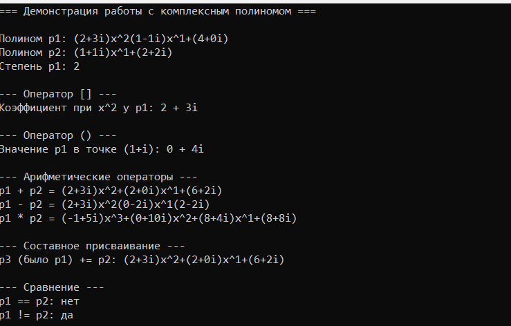
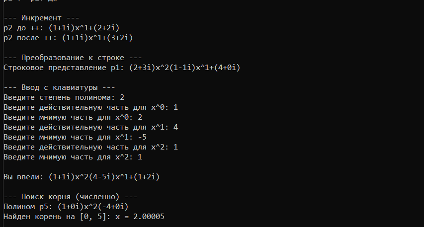

# Лабораторная работа № 5

## Перегрузка операторов и дружественные функции

**Выполнил:** Утов Алим А.

---

## 📋 Содержание

1. [Цель работы](#1-цель-работы)
2. [Задание](#2-задание)
3. [Код программы](#3-код-программы)
4. [Результаты работы программы](#4-результаты-работы-программы)
5. [Ответы на контрольные вопросы](#5-ответы-на-контрольные-вопросы)
6. [Выводы](#6-выводы)

---

## 1. Цель работы:

Научиться перегружать операторы для пользовательских классов, расширяя их функциональность и делая интерфейс классов интуитивно понятным. Освоить механизм дружественных функций и классов для предоставления доступа к закрытым членам. Закрепить на практике принципы объектно-ориентированного программирования через реализацию естественных для класса операций. Развить понимание разницы между перегрузкой операторов как методами класса и как дружественными функциями.

---

## 2. Задание:

**Продвинутый уровень. Вариант 12. Класс ComplexPolynomial (Комплексный полином).**

Общее задание: Разработать класс согласно варианту. Реализовать:
- Все возможности среднего уровня (арифметические операторы, сравнение, составное присваивание, инкремент).
- Перегрузку оператора `[]` (доступ по индексу).
- Перегрузку оператора `()` (функтор).
- Операторы преобразования типов.
- Дружественные функции для работы с разными типами (потоковый ввод/вывод).
- Исключения для обработки ошибок.

Дополнительная функциональность (Вариант 12): Поиск корней полинома (численно).

---

## 3. Код программы:

### Файл ComplexPolynomial.h (Объявление класса)

Приватные поля и публичный интерфейс

```cpp
#pragma once
#include <iostream>
#include <vector>
#include <string>
#include <utility>

using namespace std; 

class ComplexPolynomial {
private:
    vector<double> real;
    vector<double> imag;
    int degree;

public:
    // Конструкторы
    ComplexPolynomial();
    ComplexPolynomial(int deg);
    ComplexPolynomial(const vector<double>& re, const vector<double>& im);

    int getDegree() const;

    // Перегрузка операторов
    pair<double, double> operator[](int index) const;
    pair<double, double> operator()(double x, double y) const;

    ComplexPolynomial operator+(const ComplexPolynomial& other) const;
    ComplexPolynomial operator-(const ComplexPolynomial& other) const;
    ComplexPolynomial operator*(const ComplexPolynomial& other) const;
    ComplexPolynomial operator/(const ComplexPolynomial& other) const;

    ComplexPolynomial& operator+=(const ComplexPolynomial& other);
    ComplexPolynomial& operator-=(const ComplexPolynomial& other);
    ComplexPolynomial& operator*=(const ComplexPolynomial& other);

    bool operator==(const ComplexPolynomial& other) const;
    bool operator!=(const ComplexPolynomial& other) const;

    ComplexPolynomial& operator++();
    ComplexPolynomial operator++(int);

    // Преобразование типа и дружественные функции
    explicit operator string() const;

    friend ostream& operator<<(ostream& os, const ComplexPolynomial& p);
    friend istream& operator>>(istream& is, ComplexPolynomial& p);

    // Дополнительный метод
    double findRealRoot(double a, double b, double eps) const;
};
```
Файл ComplexPolynomial.cpp (Реализация методов)
Подключение библиотек и конструкторы

```cpp
#include "ComplexPolynomial.h"
#include <stdexcept>
#include <cmath>
#include <algorithm>
#include <sstream>
#include <vector>

using namespace std;

ComplexPolynomial::ComplexPolynomial() : degree(-1) {}

ComplexPolynomial::ComplexPolynomial(int deg) : degree(deg) {
    if (deg < 0) throw invalid_argument("Степень не может быть отрицательной");
    real.assign(deg + 1, 0.0);
    imag.assign(deg + 1, 0.0);
}

ComplexPolynomial::ComplexPolynomial(const vector<double>& re, const vector<double>& im) {
    if (re.size() != im.size()) throw invalid_argument("Размеры массивов должны совпадать");
    real = re;
    imag = im;
    degree = re.size() - 1;
}

int ComplexPolynomial::getDegree() const { return degree; }
```
Перегрузка операторов [] и ()

```cpp
pair<double, double> ComplexPolynomial::operator[](int index) const {
    if (index < 0 || index > degree) throw out_of_range("Индекс вне диапазона");
    return make_pair(real[index], imag[index]);
}

pair<double, double> ComplexPolynomial::operator()(double x, double y) const {
    double res_re = 0.0, res_im = 0.0;
    for (int i = degree; i >= 0; --i) {
        double new_re = res_re * x - res_im * y + real[i];
        double new_im = res_re * y + res_im * x + imag[i];
        res_re = new_re;
        res_im = new_im;
    }
    return make_pair(res_re, res_im);
}
```
Арифметические операторы +, -, *, /

```cpp
ComplexPolynomial ComplexPolynomial::operator+(const ComplexPolynomial& other) const {
    int maxDeg = max(degree, other.degree);
    ComplexPolynomial result(maxDeg);

    for (int i = 0; i <= maxDeg; ++i) {
        double r1 = (i <= degree) ? real[i] : 0.0;
        double i1 = (i <= degree) ? imag[i] : 0.0;
        double r2 = (i <= other.degree) ? other.real[i] : 0.0;
        double i2 = (i <= other.degree) ? other.imag[i] : 0.0;

        result.real[i] = r1 + r2;
        result.imag[i] = i1 + i2;
    }
    return result;
}

ComplexPolynomial ComplexPolynomial::operator-(const ComplexPolynomial& other) const {
    int maxDeg = max(degree, other.degree);
    ComplexPolynomial result(maxDeg);

    for (int i = 0; i <= maxDeg; ++i) {
        double r1 = (i <= degree) ? real[i] : 0.0;
        double i1 = (i <= degree) ? imag[i] : 0.0;
        double r2 = (i <= other.degree) ? other.real[i] : 0.0;
        double i2 = (i <= other.degree) ? other.imag[i] : 0.0;

        result.real[i] = r1 - r2;
        result.imag[i] = i1 - i2;
    }
    return result;
}

ComplexPolynomial ComplexPolynomial::operator*(const ComplexPolynomial& other) const {
    ComplexPolynomial result(degree + other.degree);

    for (int i = 0; i <= degree; ++i) {
        for (int j = 0; j <= other.degree; ++j) {
            double a = real[i], b = imag[i];
            double c = other.real[j], d = other.imag[j];

            result.real[i + j] += a * c - b * d;
            result.imag[i + j] += a * d + b * c;
        }
    }
    return result;
}

ComplexPolynomial ComplexPolynomial::operator/(const ComplexPolynomial& other) const {
    if (other.degree != 0) throw invalid_argument("Деление поддерживается только на константу");
    if (other.real[0] == 0 && other.imag[0] == 0) throw runtime_error("Деление на ноль");

    double a = other.real[0], b = other.imag[0];
    double denom = a * a + b * b;

    ComplexPolynomial result(degree);
    for (int i = 0; i <= degree; ++i) {
        double x = real[i], y = imag[i];
        result.real[i] = (x * a + y * b) / denom;
        result.imag[i] = (y * a - x * b) / denom;
    }
    return result;
}
```
Составное присваивание и операторы сравнения

```cpp
ComplexPolynomial& ComplexPolynomial::operator+=(const ComplexPolynomial& other) {
    *this = *this + other;
    return *this;
}

ComplexPolynomial& ComplexPolynomial::operator-=(const ComplexPolynomial& other) {
    *this = *this - other;
    return *this;
}

ComplexPolynomial& ComplexPolynomial::operator*=(const ComplexPolynomial& other) {
    *this = *this * other;
    return *this;
}

bool ComplexPolynomial::operator==(const ComplexPolynomial& other) const {
    if (degree != other.degree) return false;
    for (int i = 0; i <= degree; ++i) {
        if (real[i] != other.real[i] || imag[i] != other.imag[i]) return false;
    }
    return true;
}

bool ComplexPolynomial::operator!=(const ComplexPolynomial& other) const {
    return !(*this == other);
}
```
Инкремент и преобразование к строке

```cpp
ComplexPolynomial& ComplexPolynomial::operator++() {
    if (degree >= 0) real[0] += 1.0;
    return *this;
}

ComplexPolynomial ComplexPolynomial::operator++(int) {
    ComplexPolynomial temp = *this;
    ++(*this);
    return temp;
}

ComplexPolynomial::operator string() const {
    if (degree < 0) return "0";
    ostringstream oss;
    for (int i = degree; i >= 0; --i) {
        if (real[i] == 0 && imag[i] == 0) continue;

        if (i != degree && real[i] >= 0 && imag[i] >= 0) oss << "+";

        oss << "(" << real[i];
        if (imag[i] >= 0) oss << "+";
        oss << imag[i] << "i)";

        if (i > 0) oss << "x^" << i;
    }
    return oss.str();
}
```
Дружественные функции ввода/вывода и поиск корня

```cpp
ostream& operator<<(ostream& os, const ComplexPolynomial& p) {
    os << string(p);
    return os;
}

istream& operator>>(istream& is, ComplexPolynomial& p) {
    int deg;
    is >> deg;
    if (deg < 0) throw invalid_argument("Степень не может быть отрицательной");

    p = ComplexPolynomial(deg);
    for (int i = 0; i <= deg; ++i) {
        is >> p.real[i] >> p.imag[i];
    }
    return is;
}

double ComplexPolynomial::findRealRoot(double a, double b, double eps) const {
    auto f = [this](double x) {
        return (*this)(x, 0.0).first;
        };

    if (f(a) * f(b) > 0) throw runtime_error("На концах отрезка значения одного знака");

    double c;
    int iter = 0;
    while ((b - a) / 2.0 > eps && iter < 1000) {
        c = (a + b) / 2.0;
        if (f(c) == 0) return c;
        if (f(a) * f(c) < 0) b = c;
        else a = c;
        iter++;
    }
    return (a + b) / 2.0;
}
```
Файл main.cpp (Демонстрация работы)
Демонстрация операторов [], (), арифметики и присваивания

```cpp
#include <iostream>
#include <locale>
#include <windows.h>
#include <vector>
#include "ComplexPolynomial.h"

using namespace std;

int main() {
    system("chcp 1251 > nul");
    setlocale(LC_ALL, "Russian");

    cout << "=== Демонстрация работы с комплексным полиномом ===\n\n";

    // P(x) = (2+3i)x^2 + (1-1i)x + (4+0i)
    vector<double> re1 = { 4, 1, 2 };
    vector<double> im1 = { 0, -1, 3 };
    ComplexPolynomial p1(re1, im1);

    // Q(x) = (1+1i)x + (2+2i)
    vector<double> re2 = { 2, 1 };
    vector<double> im2 = { 2, 1 };
    ComplexPolynomial p2(re2, im2);

    cout << "Полином p1: " << p1 << endl;
    cout << "Полином p2: " << p2 << endl;
    cout << "Степень p1: " << p1.getDegree() << "\n\n";

    cout << "--- Оператор [] ---\n";
    auto coeff = p1[2];
    cout << "Коэффициент при x^2 у p1: " << coeff.first << " + " << coeff.second << "i\n\n";

    cout << "--- Оператор () ---\n";
    auto val = p1(1.0, 1.0);
    cout << "Значение p1 в точке (1+i): " << val.first << " + " << val.second << "i\n\n";

    cout << "--- Арифметические операторы ---\n";
    cout << "p1 + p2 = " << p1 + p2 << endl;
    cout << "p1 - p2 = " << p1 - p2 << endl;
    cout << "p1 * p2 = " << p1 * p2 << "\n\n";

    cout << "--- Составное присваивание ---\n";
    ComplexPolynomial p3 = p1;
    p3 += p2;
    cout << "p3 (было p1) += p2: " << p3 << "\n\n";

    cout << "--- Сравнение ---\n";
    cout << "p1 == p2: " << (p1 == p2 ? "да" : "нет") << endl;
    cout << "p1 != p2: " << (p1 != p2 ? "да" : "нет") << "\n\n";

    cout << "--- Инкремент ---\n";
    cout << "p2 до ++: " << p2 << endl;
    ++p2;
    cout << "p2 после ++: " << p2 << "\n\n";

    cout << "--- Преобразование к строке ---\n";
    string s = string(p1);
    cout << "Строковое представление p1: " << s << "\n\n";
```
Ввод с клавиатуры и поиск корня

```cpp
    // --- Ввод с клавиатуры с подсказками ---
    cout << "--- Ввод с клавиатуры ---\n";
    int deg;
    cout << "Введите степень полинома: ";
    cin >> deg;

    vector<double> input_re(deg + 1);
    vector<double> input_im(deg + 1);

    for (int i = 0; i <= deg; ++i) {
        cout << "Введите действительную часть для x^" << i << ": ";
        cin >> input_re[i];
        cout << "Введите мнимую часть для x^" << i << ": ";
        cin >> input_im[i];
    }

    ComplexPolynomial p4(input_re, input_im);
    cout << "\nВы ввели: " << p4 << "\n\n";

    // --- Поиск корня ---
    cout << "--- Поиск корня (численно) ---\n";
    // P(x) = x^2 - 4 (корень 2)
    vector<double> re3 = { -4, 0, 1 };
    vector<double> im3 = { 0, 0, 0 };
    ComplexPolynomial p5(re3, im3);
    cout << "Полином p5: " << p5 << endl;
    try {
        double root = p5.findRealRoot(0, 5, 0.0001);
        cout << "Найден корень на [0, 5]: x = " << root << endl;
    }
    catch (const exception& e) {
        cout << "Ошибка: " << e.what() << endl;
    }

    return 0;
}
```
---
## 4. Результаты работы программы


---
## 5. Ответы на контрольные вопросы
1. Что такое перегрузка операторов и зачем она нужна?
Перегрузка операторов — это механизм C++, позволяющий задать собственное поведение стандартных операторов (+, -, ==, [] и др.) для пользовательских типов. Она нужна для того, чтобы код был более интуитивным, естественным и читался как работа со встроенными типами (например, p1 + p2 вместо p1.add(p2)).

2. Какие операторы нельзя перегружать в С++?
Нельзя перегружать: :: (разрешение области видимости), . (доступ к члену), .* (доступ к члену по указателю), ?: (тернарный оператор), sizeof, typeid, static_cast, dynamic_cast и препроцессорные операторы.

3. В чём разница между перегрузкой оператора как метода класса и как дружественной функции?
Метод класса всегда получает левым операндом объект класса (на который указывает this). Дружественная функция — это внешняя функция, у которой оба операнда передаются как параметры, что позволяет делать перегрузку симметричной (например, 5 * vector наравне с vector * 5).

4. Для каких операторов предпочтительнее использовать дружественные функции?
Для операторов потокового ввода/вывода (<<, >>), так как левым операндом выступает std::ostream или std::istream, а не объект класса. Также для бинарных арифметических операторов, если требуется симметричность типов (например, умножение числа на комплексное число).

5. Как перегрузить префиксный и постфиксный инкремент? Чем они отличаются?

Префиксный: Type& operator++(); — увеличивает значение, возвращает ссылку на измененный объект.

Постфиксный: Type operator++(int); — принимает фиктивный параметр int, сохраняет копию текущего объекта, увеличивает оригинал и возвращает копию (старое значение).

6. Почему операторы << и >> нельзя перегрузить как методы класса?
Потому что левым операндом для этих операторов всегда является поток (std::ostream или std::istream), а не объект нашего класса. Если перегружать их как метод, то объект класса должен был бы стоять слева от оператора (obj << cout), что противоречит стандартному синтаксису.

7. Что такое дружественная функция? Каковы её особенности?
Это функция, не являющаяся членом класса, но объявленная внутри класса с ключевым словом friend. Она имеет доступ к закрытым (private) и защищённым (protected) членам класса. Особенности: не наследуется, не имеет указателя this.

8. В каких случаях стоит использовать дружественные классы?
Когда один класс должен иметь доступ к внутренним (приватным) данным другого класса для выполнения своих задач (например, паттерн «Итератор» или тесное взаимодействие двух структур).

9. Что такое оператор преобразования типа? Как его перегрузить?
Это оператор, позволяющий неявно или явно преобразовать объект пользовательского класса к другому типу. Перегружается как метод: operator Тип() const { ... }. Ключевое слово explicit запрещает неявное преобразование.

10. Как перегрузить оператор [] для доступа к элементам?
Как метод класса: Тип& operator[](int index). Обычно перегружают две версии: неконстантную (для записи) и константную const Тип& operator[](int index) const (для чтения у константных объектов).

11. Что такое функтор? Как перегрузить оператор ()?
Функтор — это объект класса, который ведет себя как функция. Перегружается как обычный метод: Тип operator()(параметры). После этого можно писать obj(аргументы).

12. Как перегрузить оператор new и delete?
Глобально или внутри класса: void* operator new(size_t size); и void operator delete(void* ptr) noexcept;. Это позволяет контролировать выделение и освобождение памяти для объектов класса.

13. Какие проблемы возникают при перегрузке операторов &&, || и ,?
При перегрузке этих операторов теряется свойство «короткого замыкания» (short-circuit evaluation), встроенное в C++. Оба операнда будут вычисляться до вызова перегруженного оператора, что может привести к неожиданным побочным эффектам.

14. Что такое "правило трёх" в контексте перегрузки операторов?
Если классу требуется перегрузка хотя бы одного из трёх: деструктора, конструктора копирования или оператора присваивания (обычно из-за управления ресурсами), то, скорее всего, нужно перегружать все три, чтобы избежать утечек и двойного удаления.

15. Как перегрузить оператор ->? Когда это может понадобиться?
Оператор -> перегружается как метод, возвращающий указатель (или объект, который сам перегружает ->). Это нужно при создании «умных указателей» (smart pointers) и итераторов, чтобы они вели себя как обычные указатели.
---
## 6. Выводы
В ходе выполнения лабораторной работы я освоил механизм перегрузки операторов в C++ и использование дружественных функций:

Научился перегружать арифметические операторы (+, -, *, /) и составное присваивание (+=, -=, *=).

Реализовал операторы сравнения (==, !=) и префиксный/постфиксный инкремент.

Освоил перегрузку оператора [] для доступа по индексу и оператора () для создания функтора.

Реализовал оператор преобразования типа (operator string).

Научился использовать дружественные функции для перегрузки << и >> (потоковый ввод/вывод).

Закрепил навыки обработки исключений при выходе за границы массива и делении на ноль.

Реализовал численный метод (бисекция) для поиска корней полинома.