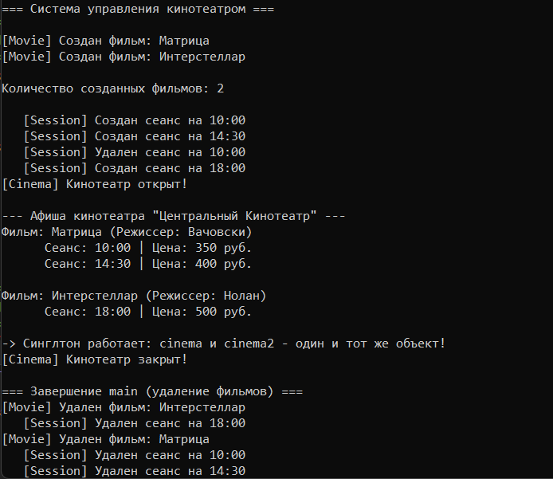

# Лабораторная работа № 1

## Отношения между классами (композиция, агрегация). Статические члены класса. Паттерн «Одиночка»

**Выполнил:** Утов Алим А.  
**Вариант:** 12 (Продвинутый уровень)

---

## 📋 Содержание

1. [Цель работы](#1-цель-работы)
2. [Задание](#2-задание)
3. [Код программы](#3-код-программы)
4. [Результаты работы программы](#4-результаты-работы-программы)
5. [Ответы на контрольные вопросы](#5-ответы-на-контрольные-вопросы)
6. [Выводы](#6-выводы)

---

## 1. Цель работы:

Научиться проектировать отношения между классами (композицию и агрегацию), освоить реализацию данных отношений в C++, понять разницу во времени жизни объектов, а также научиться использовать статические поля и реализовывать паттерн проектирования «Одиночка» (Singleton).

---

## 2. Задание:

**Вариант 12 (Продвинутый уровень).**

Разработать систему управления кинотеатром:
- **Cinema (Кинотеатр)** — реализовать как паттерн «Одиночка» (Singleton).
- **Movie (Фильм)** — связан с Cinema отношением агрегации (фильмы существуют независимо от кинотеатра).
- **Session (Сеанс)** — связан с Movie отношением композиции (сеанс не может существовать без фильма).
- Добавить статическое поле для подсчета количества созданных объектов Movie.
- Продемонстрировать работу всех реализованных возможностей.

---

## 3. Код программы:

### Файл Classes.h (Заголовочный файл)

Класс Session (часть для композиции) и класс Movie (целое)

```cpp
#pragma once
#include <iostream>
#include <string>
#include <vector>

using namespace std;

// 1. КЛАСС "ЧАСТЬ" (Session) - КОМПОЗИЦИЯ
class Session {
private:
    string startTime; 
    double price;     
public:
    Session(const string& time, double p);
    ~Session();
    void print() const;
};

// 2. КЛАСС "ЦЕЛОЕ" ДЛЯ КОМПОЗИЦИИ (Movie)
class Movie {
private:
    string title;
    string director;
    vector<Session> sessions; 
    static int movieCount;    // Статическое поле-счетчик
public:
    Movie(const string& t, const string& d);
    ~Movie();
    void addSession(const string& time, double price);
    void print() const;
    string getTitle() const;
    static int getMovieCount(); 
};
```
Класс Cinema (паттерн «Одиночка»)

```cpp

// 3. КЛАСС "КИНОТЕАТР" (Cinema) - ОДИНОЧКА

class Cinema {
private:
    string name;
    vector<Movie*> movies; // Агрегация: храним указатели

    // Строгий Singleton
    Cinema(); 
    ~Cinema(); 
    Cinema(const Cinema&) = delete; 
    Cinema& operator=(const Cinema&) = delete;

    static Cinema* instance; 

public:
    static Cinema* getInstance();       
    static void destroyInstance();      

    void addMovie(Movie* movie);
    void print() const;
};

```
Файл Classes.cpp (Реализация методов)
Инициализация статических полей и реализация Session

```cpp
#include "Classes.h"

// Инициализация статических полей
int Movie::movieCount = 0;
Cinema* Cinema::instance = nullptr;

// РЕАЛИЗАЦИЯ Session
Session::Session(const string& time, double p) : startTime(time), price(p) {
    cout << "   [Session] Создан сеанс на " << startTime << endl;
}
Session::~Session() {
    cout << "   [Session] Удален сеанс на " << startTime << endl;
}
void Session::print() const {
    cout << "      Сеанс: " << startTime << " | Цена: " << price << " руб." << endl;
}
```
Реализация Movie

```cpp
// РЕАЛИЗАЦИЯ Movie
Movie::Movie(const string& t, const string& d) : title(t), director(d) {
    movieCount++;
    cout << "[Movie] Создан фильм: " << title << endl;
}
Movie::~Movie() {
    cout << "[Movie] Удален фильм: " << title << endl;
}
void Movie::addSession(const string& time, double price) {
    sessions.emplace_back(time, price); 
}
void Movie::print() const {
    cout << "Фильм: " << title << " (Режиссер: " << director << ")" << endl;
    for (const auto& s : sessions) {
        s.print();
    }
}
string Movie::getTitle() const { return title; }
int Movie::getMovieCount() { return movieCount; }
```
Реализация Cinema (Singleton)

```cpp

// РЕАЛИЗАЦИЯ Cinema
Cinema::Cinema() : name("Центральный Кинотеатр") {
    cout << "[Cinema] Кинотеатр открыт!" << endl;
}
Cinema::~Cinema() {
    cout << "[Cinema] Кинотеатр закрыт!" << endl;
}
Cinema* Cinema::getInstance() {
    if (instance == nullptr) {
        instance = new Cinema(); 
    }
    return instance;
}
void Cinema::destroyInstance() {
    if (instance != nullptr) {
        delete instance;
        instance = nullptr;
    }
}
void Cinema::addMovie(Movie* movie) {
    if (movie != nullptr) { 
        movies.push_back(movie);
    }
}
void Cinema::print() const {
    cout << "\n--- Афиша кинотеатра \"" << name << "\" ---" << endl;
    for (const auto* m : movies) {
        m->print();
        cout << endl;
    }
}
```
Файл main.cpp (Демонстрация работы)
```cpp
#include <iostream>
#include <locale>
#include <windows.h>
#include "Classes.h"

using namespace std;

int main() {
    system("chcp 1251 > nul");
    setlocale(LC_ALL, "Russian");

    cout << "=== Система управления кинотеатром ===\n" << endl;

    Movie movie1("Матрица", "Вачовски");
    Movie movie2("Интерстеллар", "Нолан");

    cout << "\nКоличество созданных фильмов: " << Movie::getMovieCount() << "\n" << endl;

    movie1.addSession("10:00", 350.0);
    movie1.addSession("14:30", 400.0);
    movie2.addSession("18:00", 500.0);

    Cinema* cinema = Cinema::getInstance();
    cinema->addMovie(&movie1);
    cinema->addMovie(&movie2);

    cinema->print();

    Cinema* cinema2 = Cinema::getInstance();
    if (cinema == cinema2) {
        cout << "-> Синглтон работает: cinema и cinema2 - один и тот же объект!" << endl;
    }

    Cinema::destroyInstance();

    cout << "\n=== Завершение main (удаление фильмов) ===" << endl;
    return 0;
}
```
## 4. Результаты работы программы


 сначала закрывается кинотеатр, затем удаляются фильмы, и в последнюю очередь — сеансы внутри фильмов.

## 5. Ответы на контрольные вопросы
1. Что такое композиция? Приведите пример.
Композиция — это отношение «часть–целое», при котором части не могут существовать без целого. При уничтожении целого уничтожаются и его части. Пример: Фильм (Movie) и Сеанс (Session). Сеанс не имеет смысла без фильма.

2. Что такое агрегация? Чем она отличается от композиции?
Агрегация — это тоже отношение «часть–целое», но части могут существовать независимо от целого. Целое не отвечает за создание и уничтожение частей. Отличие: при композиции часть умирает вместе с целым, а при агрегации — продолжает жить. Пример: Кинотеатр (Cinema) и Фильм (Movie).

3. Как реализовать композицию в C++? Приведите пример кода.
Через поле-объект (без указателей) или через умные указатели. Например, в классе Movie есть vector<Session> sessions;. При удалении фильма вектор автоматически вызовет деструкторы для всех сеансов.

4. Как реализовать агрегацию в C++? Приведите пример кода.
Через указатели или ссылки. Например, в классе Cinema есть vector<Movie*> movies;. В деструкторе Cinema мы не вызываем delete для фильмов, они удаляются отдельно.

5. В чём разница между временем жизни частей при композиции и агрегации?
При композиции время жизни части равно или меньше времени жизни целого. При агрегации время жизни части не зависит от целого (часть может быть создана до целого и удалена после него).

6. Что такое статическое поле класса? Чем оно отличается от обычного?
Статическое поле принадлежит всему классу, а не конкретному объекту. Оно существует в единственном экземпляре для всех объектов класса. Обычное поле — у каждого объекта свое.

7. Как объявить и определить статическое поле? Где оно хранится?
Объявление внутри класса: static int count;. Определение вне класса (обычно в .cpp): int MyClass::count = 0;. Хранится в статической области памяти (сегмент данных).

8. Что такое статический метод? Можно ли из него обратиться к нестатическим полям?
Статический метод принадлежит классу и может быть вызван без создания объекта. Из него нельзя обратиться к нестатическим полям, так как у него нет указателя this на конкретный объект.

9. Для чего используются статические счётчики объектов?
Для подсчета количества созданных и живых объектов класса. Они увеличиваются в конструкторе и уменьшаются в деструкторе.

10. Что такое паттерн «Одиночка» (Singleton)? Для чего он нужен?
Это паттерн, который гарантирует наличие только одного экземпляра класса и предоставляет глобальную точку доступа к нему. Нужен, когда требуется ровно один объект (например, логгер, настройки, главный кинотеатр).

11. Как запретить создание копий объекта (конструктор копирования)?
С помощью ключевого слова delete: MyClass(const MyClass&) = delete; и MyClass& operator=(const MyClass&) = delete;.

12. В каком порядке вызываются конструкторы и деструкторы при композиции?
Конструкторы: сначала части, затем целого. Деструкторы: сначала целого, затем частей.

13. Можно ли изменить статическое поле из обычного метода?
Да, обычный метод имеет доступ к статическим полям класса.

14. Почему статические поля нужно определять вне класса?
Объявление внутри класса только сообщает компилятору о существовании поля. Определение вне класса (в .cpp) выделяет для него реальную память.

15. В каких случаях стоит использовать композицию, а в каких - агрегацию?
Композиция — когда часть является неотъемлемой частью целого (Дом и Комнаты, Фильм и Сеансы). Агрегация — когда части самостоятельны и могут быть общими (Кинотеатр и Фильмы, Библиотека и Книги).

## 6. Выводы
В ходе работы я изучил, как проектировать отношения между классами. Я реализовал композицию (фильм и сеансы) и агрегацию (кинотеатр и фильмы).

Также я научился использовать статические поля для подсчета объектов (счетчик movieCount в классе Movie) и реализовал паттерн «Одиночка» с помощью приватных конструктора и деструктора, а также удаленных конструктора копирования и оператора присваивания.

Продемонстрирована разница во времени жизни объектов: при выходе из main первым уничтожается кинотеатр (вызванный через destroyInstance), затем удаляются фильмы, и только после этого — сеансы внутри них.