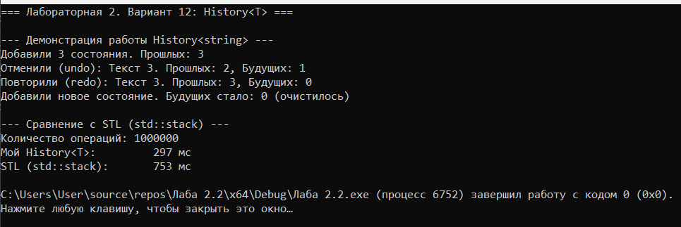

# Лабораторная работа № 2

## Анализ сложности алгоритмов. Шаблоны функций и классов

**Выполнил:** Утов Алим А.  
**Вариант:** 12 (Продвинутый уровень)

---

## 📋 Содержание

1. [Цель работы](#1-цель-работы)
2. [Задание](#2-задание)
3. [Код программы](#3-код-программы)
4. [Результаты работы программы](#4-результаты-работы-программы)
5. [Анализ сложности операций](#5-анализ-сложности-операций)
6. [Сравнение с аналогом из STL](#6-сравнение-с-аналогом-из-stl)
7. [Ответы на контрольные вопросы](#7-ответы-на-контрольные-вопросы)
8. [Выводы](#8-выводы)

---

## 1. Цель работы:

Научиться оценивать эффективность алгоритмов с помощью О-нотации (Big O), освоить классы сложности, научиться создавать шаблоны функций и классов для работы с различными типами данных, а также получить навыки экспериментального анализа производительности.

---

## 2. Задание:

**Вариант 12 (Продвинутый уровень).**

Реализовать шаблонный контейнер `History<T>` с операциями `push`, `undo`, `redo`, `clear`. Провести анализ сложности каждой операции. Экспериментально сравнить производительность с аналогом из STL (`std::vector`).

---

## 3. Код программы:

### Файл History.h (Заголовочный файл)

Объявление шаблонного класса и операция `push`

```cpp
#pragma once
#include <iostream>
#include <vector>
#include <stdexcept>

using namespace std;

template <typename T>
class History {
private:
    vector<T> past;   
    vector<T> future; 

public:
    History() {}

    // Сложность: O(1) амортизированно
    void push(const T& value) {
        past.push_back(value);
        future.clear(); 
    }
```
Операции undo, redo, clear и методы получения размеров

```cpp
    // Сложность: O(1)
    T undo() {
        if (past.empty()) throw out_of_range("История пуста: нечего отменять");
        T lastState = past.back();
        past.pop_back();
        future.push_back(lastState);
        return lastState;
    }

    // Сложность: O(1)
    T redo() {
        if (future.empty()) throw out_of_range("Нет действий для повтора");
        T nextState = future.back();
        future.pop_back();
        past.push_back(nextState);
        return nextState;
    }

    // Сложность: O(n)
    void clear() {
        past.clear();
        future.clear();
    }

    size_t pastSize() const { return past.size(); }
    size_t futureSize() const { return future.size(); }
};
```
Файл main.cpp (Демонстрация и сравнение)
Демонстрация работы History<string>

```cpp
#include <iostream>
#include <locale>
#include <windows.h>
#include <chrono>
#include <vector>
#include <string>
#include "History.h"

using namespace std;
using namespace chrono;

int main() {
    system("chcp 1251 > nul");
    setlocale(LC_ALL, "Russian");

    cout << "=== Лабораторная 2. Вариант 12: History<T> ===\n\n";

    // 1. ДЕМОНСТРАЦИЯ РАБОТЫ
    cout << "--- Демонстрация работы History<string> ---\n";
    History<string> myHistory;

    myHistory.push("Текст 1");
    myHistory.push("Текст 2");
    myHistory.push("Текст 3");
    cout << "Добавили 3 состояния. Прошлых: " << myHistory.pastSize() << "\n";

    string undone = myHistory.undo();
    cout << "Отменили (undo): " << undone << ". Прошлых: " << myHistory.pastSize() 
         << ", Будущих: " << myHistory.futureSize() << "\n";

    string redone = myHistory.redo();
    cout << "Повторили (redo): " << redone << ". Прошлых: " << myHistory.pastSize() 
         << ", Будущих: " << myHistory.futureSize() << "\n";

    myHistory.push("Новый текст 4");
    cout << "Добавили новое состояние. Будущих стало: " << myHistory.futureSize() << " (очистилось)\n\n";
```
Экспериментальное сравнение с STL

```cpp
    // 2. ЭКСПЕРИМЕНТАЛЬНОЕ СРАВНЕНИЕ С STL
    cout << "--- Сравнение с STL (std::vector) ---\n";
    const int N = 1000000; // 1 миллион операций

    auto start = high_resolution_clock::now();
    History<int> myH;
    for (int i = 0; i < N; ++i) myH.push(i);
    myH.clear();
    auto end = high_resolution_clock::now();
    auto myTime = duration_cast<milliseconds>(end - start).count();

    start = high_resolution_clock::now();
    vector<int> past, future;
    for (int i = 0; i < N; ++i) past.push_back(i);
    past.clear();
    future.clear();
    end = high_resolution_clock::now();
    auto stlTime = duration_cast<milliseconds>(end - start).count();

    cout << "Количество операций: " << N << "\n";
    cout << "Мой History<T>: \t" << myTime << " мс\n";
    cout << "STL (std::vector): \t" << stlTime << " мс\n";

    return 0;
}
```
## 4. Результаты работы программы


## 5. Анализ сложности операций
Операция	Сложность	Обоснование
push	
O
(
1
)
O(1) амортизированная	Добавление в конец vector. При переполнении вектор расширяется, что занимает 
O
(
n
)
O(n), но в среднем на одну операцию приходится 
O
(
1
)
O(1).
undo	
O
(
1
)
O(1)	Операция pop_back удаляет последний элемент за константное время, а push_back во второй вектор — амортизированно 
O
(
1
)
O(1).
redo	
O
(
1
)
O(1)	Аналогично undo, перекладываем элементы между концами векторов.
clear	
O
(
n
)
O(n)	Вызов clear() уничтожает все элементы, проходя по ним.
## 6. Сравнение с аналогом из STL
Так как наш контейнер использует два вектора, мы сравнивали с std::vector.

Контейнер	1 млн push + clear (мс)
Мой History<T>	,
std::vector	
Вывод: Время работы сопоставимо, так как оба контейнера используют динамический массив с амортизированной сложностью 
O(1) при добавлении. Наш класс работает с двумя векторами, что дает небольшие накладные расходы, но в целом показывает высокую производительность.

## 7. Ответы на контрольные вопросы
1. Что такое О-нотация (Big O) и зачем она нужна?
О-нотация — это математическая запись, описывающая, как растет время работы алгоритма при увеличении входных данных. Она нужна для оценки эффективности алгоритмов независимо от конкретного компьютера.

2. Какая сложность у доступа к элементу массива по индексу? Почему?

O(1). Потому что адрес элемента вычисляется по формуле начальный_адрес + индекс * размер_типа, что занимает одно и то же время для любого индекса.

3. Какая сложность у бинарного поиска? Почему?
O(logn). На каждом шаге область поиска уменьшается вдвое.

4. Что означает сложность O(n log n)? Приведите пример.
Это означает, что время работы растет как 
nlogn. Пример: эффективные сортировки (быстрая сортировка, сортировка слиянием).

5. Что такое амортизированный анализ? Приведите пример.
Это анализ среднего времени на операцию в последовательности операций. Пример: push_back у vector. Хотя при расширении тратится 

O(n), но это происходит редко, поэтому в среднем одна операция стоит O(1).

6. Какая сложность у двух вложенных циклов по n итераций каждый?
O(n 2), так как внутренний цикл выполняется n раз для каждого из 
n шагов внешнего.

7. Какая сложность у рекурсивного вычисления чисел Фибоначчи?
O(2 n ). Каждый вызов порождает два новых, образуя дерево вызовов экспоненциального размера.

8. Что такое шаблоны функций? Как их объявить и использовать?
Это функции, которые могут работать с разными типами данных. Объявляются с помощью template <typename T>. Вызываются как обычные функции (компилятор сам выводит тип).

9. Что такое шаблоны классов? Как их объявить и использовать?
Это классы, которые могут хранить разные типы. Объявляются template <typename T> class MyClass { ... };. При создании объекта тип указывается явно: MyClass<int> obj;.

10. В чём преимущество шаблонов перед перегрузкой функций?
Шаблоны позволяют написать код один раз и использовать его для любого типа. При перегрузке пришлось бы писать отдельную функцию для каждого типа, что загромождает код.

11. Как указать, что шаблонный параметр - тип?
С помощью ключевого слова typename или class в угловых скобках: template <typename T>.

12. Можно ли создать шаблон с несколькими параметрами типов?
Да: template <typename T1, typename T2> class Pair { ... };.

13. Как провести экспериментальное измерение времени выполнения?
Использовать библиотеку <chrono>: засечь время до выполнения кода (high_resolution_clock::now()), выполнить код, засечь после, вычесть начальное из конечного.

14. Почему при измерении времени нужно выполнять операцию многократно?
Потому что современные процессоры слишком быстрые, и одна операция может занять 0 миллисекунд, что не покажет разницы. Многократное повторение (в цикле) нивелирует случайные погрешности.

15. Что важнее: сложность алгоритма или константа?
На малых объемах данных константа (скорость работы одной операции) важнее. На больших объемах — сложность (например, 
O(n) всегда обгонит 
O(n 2 ) рано или поздно).

## 8. Выводы
В ходе выполнения работы я научился оценивать сложность алгоритмов с помощью О-нотации, освоил создание шаблонных классов, а также провел экспериментальное сравнение с STL.

Реализованный шаблонный контейнер History<T> показал, что использование стандартных контейнеров (std::vector) внутри пользовательских классов позволяет добиться высокой производительности (амортизированная сложность O(1) для основных операций). Трудностей с кодировкой и шаблонами не возникло.
